# Payables Desk — Architecture

> Technical reference for how the Payables Desk prototype works: every component, every workflow, and the invariants
> that keep money safe. Diagrams are [Mermaid](https://mermaid.js.org/) and render on GitHub / most Markdown viewers.

**What the system does, in one paragraph.** Invoices and emails land in an inbox folder. A crash-safe state machine
reads each document, validates it, resolves the vendor, matches it to a purchase order and goods receipts, runs
duplicate / bank / sender checks (several of them against **live Crustdata and Razorpay IFSC data**), and decides
`PAY_ELIGIBLE`, `HOLD` or `BLOCK` from a fixed table of reason codes. Eligible invoices go into a weekly, cash-aware
payment plan (legal deadlines → discounts → priority-weighted instalments). A human approves the plan, and an
exactly-once payout executor pays each instalment through a payment provider using a frozen idempotency key. Every
fact, state change, external call and credit spent is written to an append-only ledger.

---

## Contents

1. [Tech stack and repository layout](#1-tech-stack-and-repository-layout)
2. [System context](#2-system-context)
3. [Module map and dependencies](#3-module-map-and-dependencies)
4. [Configuration and source modes](#4-configuration-and-source-modes)
5. [Data model](#5-data-model)
6. [End-to-end user workflow (UI)](#6-end-to-end-user-workflow-ui)
7. [Prompt → run request (`intent`)](#7-prompt--run-request-intent)
8. [Ingest and the invoice pipeline (`pipeline`)](#8-ingest-and-the-invoice-pipeline-pipeline)
9. [Reason codes and the decision engine (`reasons`)](#9-reason-codes-and-the-decision-engine-reasons)
10. [Document extraction (`extract`)](#10-document-extraction-extract)
11. [Deterministic validators (`validators`)](#11-deterministic-validators-validators)
12. [External sources layer (`sources`)](#12-external-sources-layer-sources)
13. [Trust and priority scoring (`scoring`)](#13-trust-and-priority-scoring-scoring)
14. [Receivables forecast and cash position](#14-receivables-forecast-and-cash-position)
15. [Payment planning (`scheduler`)](#15-payment-planning-scheduler)
16. [Exactly-once payment execution (`payments`)](#16-exactly-once-payment-execution-payments)
17. [Bank-change fraud defence](#17-bank-change-fraud-defence)
18. [Evidence and audit ledger (`ledger`)](#18-evidence-and-audit-ledger-ledger)
19. [Human-in-the-loop actions](#19-human-in-the-loop-actions)
20. [Background worker](#20-background-worker)
21. [Weekly summary (`summary`)](#21-weekly-summary-summary)
22. [Accounting import (`importer`)](#22-accounting-import-importer)
23. [Scripts, test harness and crash demo](#23-scripts-test-harness-and-crash-demo)
24. [Failure handling matrix](#24-failure-handling-matrix)
25. [Safety invariants (summary)](#25-safety-invariants-summary)
26. [Swap points for production](#26-swap-points-for-production)

---

## 1. Tech stack and repository layout

| Concern | Choice |
|---|---|
| Language | Python 3 (stdlib-heavy; `httpx` for HTTP) |
| UI | Streamlit (single page, screens routed through `st.session_state`, overlays via `st.dialog`) |
| Database | SQLite in WAL mode (same schema/constraints as the planned Postgres/Supabase design) |
| Money | Integer **paise** everywhere; `Decimal` with `ROUND_HALF_UP` for parsing/rounding |
| Live data | Crustdata REST API (`api-version 2025-11-01`), Razorpay IFSC API |
| LLM (optional) | Gemini (`gemini-2.5-flash`) for field extraction / intent fallback only — never for decisions |
| Payments | `MockProvider` (default) or `RazorpayXProvider` (test keys only) |

```
CrustData/
├── app/                      # domain core (no Streamlit imports)
│   ├── config.py             # .env + env vars, thresholds, modes
│   ├── db.py                 # SQLite schema, triggers, migrations, tx() helper
│   ├── money.py              # paise parsing, rounding, ₹ Indian-grouping formatter
│   ├── validators.py         # GSTIN/IFSC/PAN, name normalisation, homoglyphs, edit distance
│   ├── extract.py            # .txt/.eml → structured invoice or bank-change dict
│   ├── intent.py             # chat prompt → RunRequest (scope, action, refused overrides)
│   ├── pipeline.py           # invoice state machine (ingest → decide), human release/recheck
│   ├── reasons.py            # reason-code → severity table, ordering
│   ├── sources.py            # Crustdata + IFSC wrapper: ceilings, faults, cache, replay, retry
│   ├── scoring.py            # vendor trust (gate) + priority (order), adverse-news matcher
│   ├── receivables.py        # customer payment-confidence forecast
│   ├── scheduler.py          # cash position + tiered payment allocation + run approval
│   ├── payments.py           # provider protocol + exactly-once executor
│   ├── bank_verify.py        # verify a pasted bank-change email/SMS
│   ├── vendor_admin.py       # maker-checker bank-change checklist
│   ├── ledger.py             # facts / events / calls / raw_responses writers
│   ├── summary.py            # weekly gist read model for the Results screen
│   ├── importer.py           # AccountingSource protocol + CSV/Tally importer
│   └── worker.py             # restartable background loop
├── ui/
│   ├── Home.py               # router: chat → results → paywall → receipt
│   ├── common.py             # page chrome, fact/reason renderers, badges
│   └── screens/              # chat.py, results.py, paywall.py, overlays.py
├── scripts/                  # setup_demo, run_test_set, crash_demo, record_live, generate_mock_data
├── data/
│   ├── inbox/                # documents to evaluate (case01…case19)
│   ├── inbox_followup/       # documents used by follow-up test cases (case20, case20b)
│   ├── seed/                 # vendors, POs, GRNs, bank accounts, customers, receivables, bank position, Tally export
│   ├── golden/expected.json  # expected outcomes for the golden test set
│   ├── live_recordings.json  # REAL recorded Crustdata/IFSC responses (replay mode)
│   ├── mock_sources.json     # synthetic fixtures (mock mode)
│   └── penny_drop_mock.json  # penny-drop provider fixture
└── tests/test_intent.py      # prompt-parser unit tests
```

---

## 2. System context

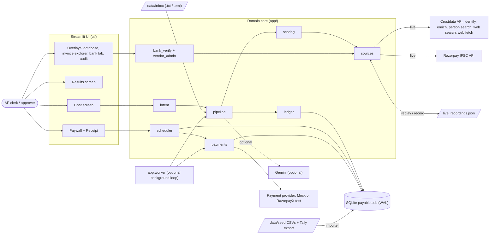

The UI never contains business logic: every screen calls into `app/`, and `app/` never imports Streamlit. The same
core is driven by the UI, the background worker, the golden test runner and the crash demo.

---

## 3. Module map and dependencies

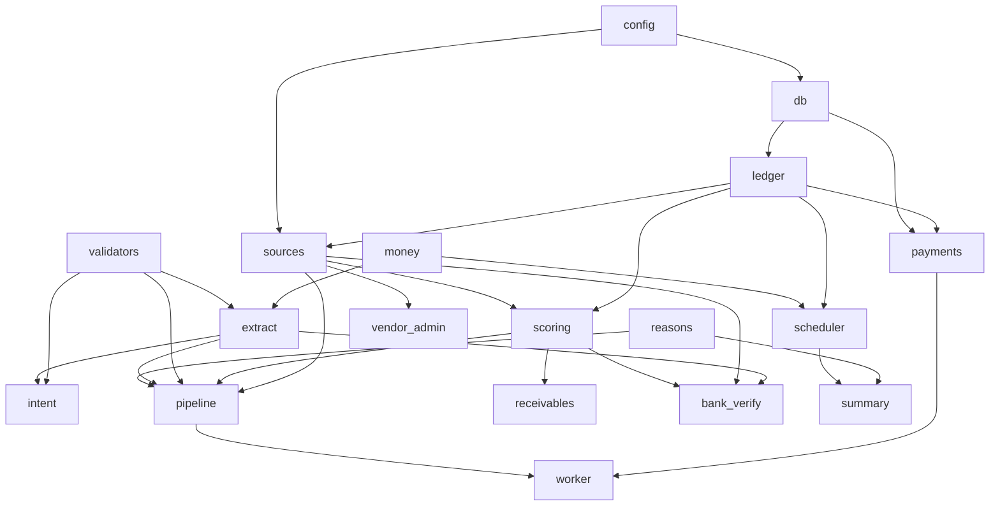

| Layer | Modules | Responsibility |
|---|---|---|
| Foundation | `config`, `db`, `money`, `validators` | Settings, schema, invariants, pure functions |
| Evidence | `ledger` | Append-only facts/events, call/cost accounting, raw responses |
| Integration | `sources`, `extract`, `importer` | Everything that talks to the outside world (APIs, files, LLM) |
| Domain | `pipeline`, `reasons`, `scoring`, `receivables`, `scheduler`, `payments`, `bank_verify`, `vendor_admin` | Decisions, plans, money movement |
| Read models | `summary` | Aggregations for the UI |
| Drivers | `ui/*`, `worker`, `scripts/*` | Entry points |

---

## 4. Configuration and source modes

`app/config.py` loads `.env` (without overriding real environment variables) and exposes constants.

| Setting | Default | Meaning |
|---|---|---|
| `DB_PATH` | `data/payables.db` | SQLite file |
| `INBOX_DIR` | `data/inbox` | Folder scanned by `ingest` |
| `RUN_DATE` | `2026-11-22` | "Today" for all date logic (deterministic demos/tests) |
| `HORIZON_DAYS` | `7` | Payment-run look-ahead window |
| `COST_OF_CASH` | `0.12` | Annual hurdle rate for taking early-payment discounts |
| `RUN_TIME_LIMIT_S` / `RUN_CREDIT_LIMIT` | `900` / `200` | Per-run ceilings checked before every external call |
| `CRUSTDATA_MODE` / `IFSC_MODE` | `replay` | `live` · `replay` · `mock` (see below) |
| `RECORD_LIVE` | `1` | In live mode, append responses to `live_recordings.json` |
| `GEMINI_API_KEY`, `LLM_MODEL` | empty, `gemini-2.5-flash` | Optional extraction / intent fallback |
| `PAYMENT_PROVIDER` | `mock` | `mock` or `razorpayx` (refuses `rzp_live_` keys) |

Hard-coded decision parameters: `TRUST_GATE = 0.4`, `PRICE_TOLERANCE = 0.02`, `MIN_INSTALMENT_PCT = 0.25`,
`MIN_INSTALMENT_PAISE = ₹10,000`, `MAX_INSTALMENTS = 3`, `RECEIPT_CONFIDENCE_MIN = 0.7`, `MAX_INVOICE_AGE_DAYS = 180`.

### Source modes

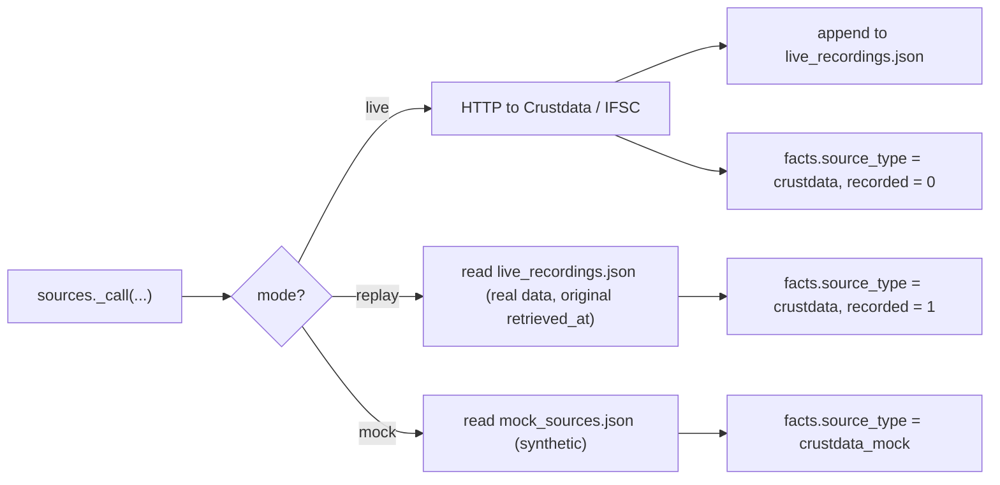

The labelling rule is strict: replayed data is **real** data and is shown as "🌐 live, recorded <date>"; mock fixtures
always carry a `_mock` suffix so a synthetic value can never be displayed as live.

---

## 5. Data model

All money columns are `INTEGER` paise. Timestamps are ISO-8601 UTC text. Every connection runs with
`journal_mode=WAL`, `foreign_keys=ON`, `busy_timeout=30000`, and every state transition goes through
`db.tx()` (`BEGIN IMMEDIATE … COMMIT/ROLLBACK`).

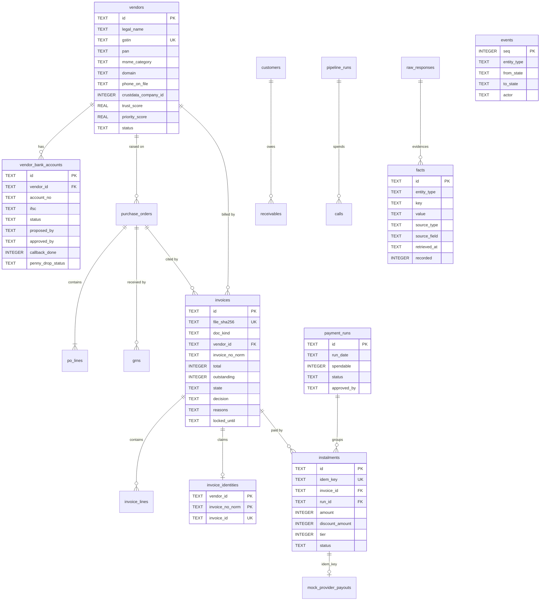

Tables not drawn above: `po_lines`/`grns` details, `customers`, `receivables`, `pipeline_runs`, `calls`,
`raw_responses`, `cache`.

### Invariants enforced by the database itself

| Invariant | Mechanism |
|---|---|
| A file is ingested once | `invoices.file_sha256 UNIQUE` + `INSERT OR IGNORE` |
| An invoice identity (vendor + normalised number) is payable at most once | `invoice_identities` PK `(vendor_id, invoice_no_norm)` |
| A vendor has at most one current bank account | partial unique index `one_current_account … WHERE status='current'` |
| Maker ≠ checker on bank accounts | `CHECK (approved_by <> proposed_by)` |
| Can't invoice more than ordered | `po_lines CHECK (qty_invoiced <= qty_ordered)` |
| Instalments never exceed the invoice total | trigger `instalments_cap` (sum of live instalments + discounts ≤ total) |
| One payout per idempotency key | `instalments.idem_key UNIQUE`, `mock_provider_payouts.idem_key PK` |
| Outstanding never negative | `CHECK (outstanding >= 0)` |
| Audit trail is append-only | triggers abort any `UPDATE`/`DELETE` on `events` and `facts` |

`db.init_schema()` runs `CREATE … IF NOT EXISTS` then applies `MIGRATIONS` (column adds) for databases created by
older builds.

---

## 6. End-to-end user workflow (UI)

`ui/Home.py` is a router: `st.session_state.screen ∈ {chat, results, paywall, receipt}` selects a render
function. There is no sidebar; secondary views are `st.dialog` overlays (Streamlit allows one open dialog at a time,
so the bank-change flow lives as a tab inside the invoice overlay).

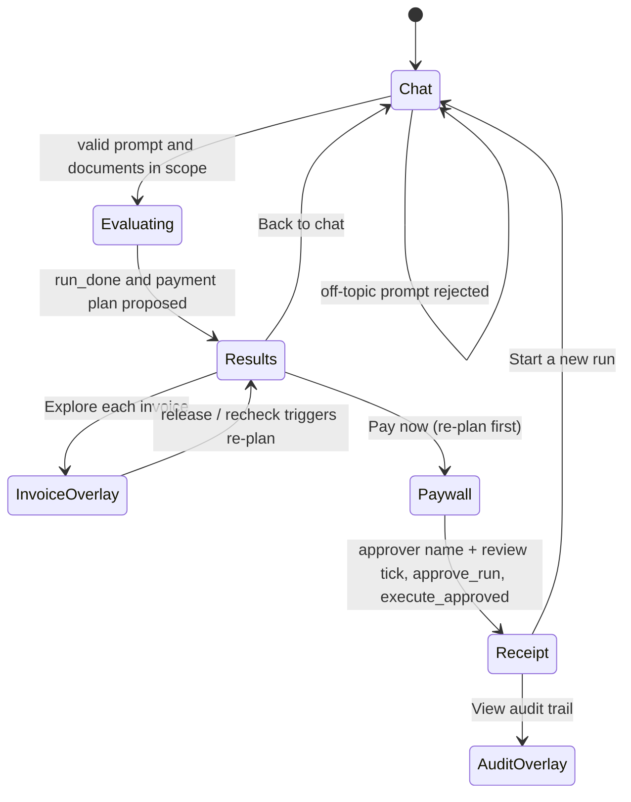

### Live evaluation sequence

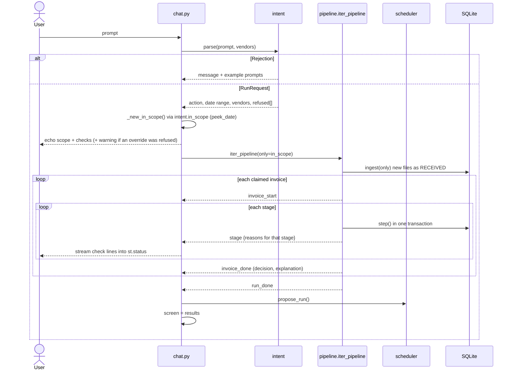

### Overlays

| Overlay | Content |
|---|---|
| **Invoice database** | Tabs: Inbox (with evaluation status + preview), Vendors, Purchase orders, Goods receipts, Bank accounts, Receivables |
| **Add invoices** | Upload `.txt`/`.eml` into the inbox folder |
| **Explore each invoice** | Ordered held → blocked → payable. Tabs: *Why* (reasons with expandable evidence facts + Re-check / Release actions), *Details* (extracted fields, MSME clock, tier classification), *Vendor* (trust/priority breakdowns), *🏦 Bank details* (paste-and-verify + maker-checker checklist) |
| **Audit trail** | Payments (instalments + provider refs), Events (last 300), Calls & cost (credits, ₹, latency) |

---

## 7. Prompt → run request (`intent`)

The chat prompt chooses **which documents** to look at. It can never switch a check off.

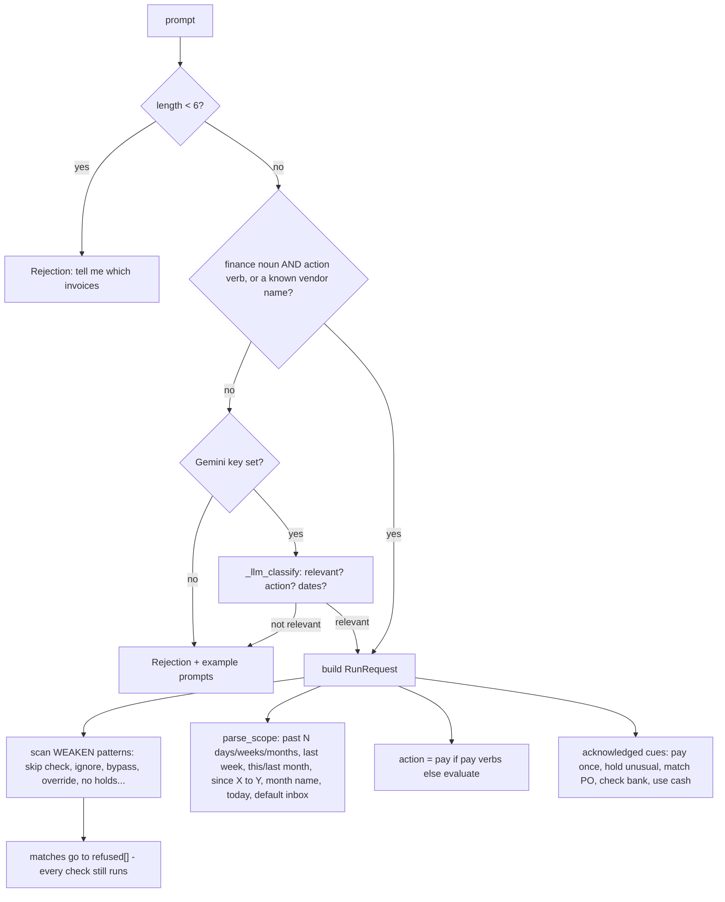

`RunRequest = {action, date_from, date_to, scope_label, vendors[], acknowledged[], refused[], source}`.

Scope is applied **before ingest** by `in_scope(path, req)`: optional vendor-name filter on the file text, then
`peek_date()` reads the invoice date cheaply (label lines, the `BILL | … | Date` layout, or the email `Date:` header)
without touching the DB or the LLM. Out-of-scope files stay un-ingested so a later run can still pick them up.

Notable parsing rules: "past week" is rolling 7 days, "last week" is the previous calendar Monday–Sunday; a bare
"may" is only treated as a month in phrases like "May invoices". Unit tests live in `tests/test_intent.py`.

---

## 8. Ingest and the invoice pipeline (`pipeline`)

### 8.1 State machine

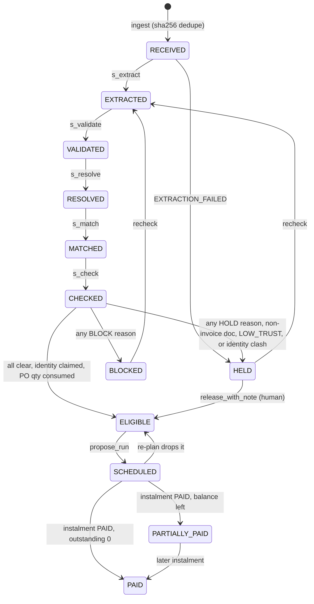

Any stage that raises an unexpected exception is retried; on the 3rd failure the invoice goes to `HELD` with
`PIPELINE_ERROR`.

### 8.2 Execution model

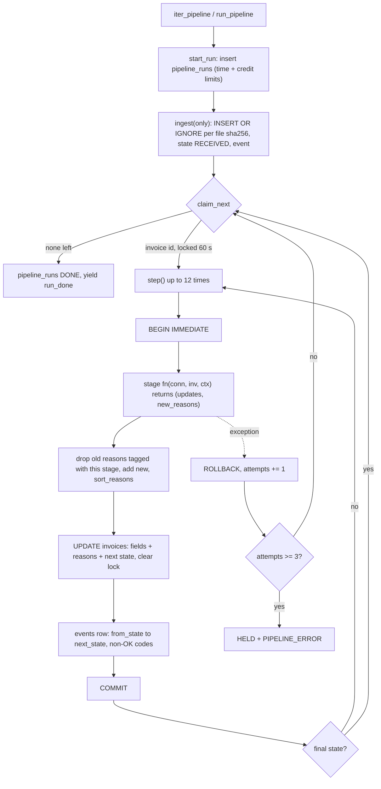

Key properties:

- **One transaction per transition**: state update, reasons, facts and the `events` row commit together or not at all.
- **Idempotent stages**: each reason carries a `stage` tag; re-running a stage replaces only its own reasons.
- **Work claiming**: `claim_next` picks the oldest unfinished invoice whose `locked_until` is null/expired and locks it
  for 60 s — the SQLite equivalent of `SELECT … FOR UPDATE SKIP LOCKED`, so a UI run and the worker don't collide.
- **Streaming**: `iter_pipeline` is a generator yielding `invoice_start`, `stage`, `invoice_done`, `run_done` events;
  `run_pipeline` just drains it.

### 8.3 Stages in detail

| Stage | Function | What it does | Reasons it can emit |
|---|---|---|---|
| extract | `s_extract` | Cache lookup by `extract:<sha256>`; otherwise `extract()` (2 attempts). Writes one `facts` row per extracted field (source = the file + sha prefix), replaces `invoice_lines`, normalises invoice number, computes `content_hash`. | `EXTRACTED` ✅, `EXTRACTION_FAILED` |
| validate | `s_validate` | Lines sum = subtotal (±₹1), subtotal + tax = total; GSTIN regex + mod-36 checksum; date not in future / not > 180 days old; IFSC format. | `ARITHMETIC_OK/MISMATCH`, `GSTIN_FORMAT`, `INVALID_GSTIN` (BLOCK), `GSTIN_CHECKSUM_OK`, `INVOICE_DATE_FUTURE`, `INVOICE_TOO_OLD`, `IFSC_FORMAT` |
| resolve | `s_resolve` | Vendor by **GSTIN first** (name variants auto-added as aliases); else by name: exact, homoglyph `skeleton`, or ≥ 0.85 similarity lookalike; unknown vendors trigger a Crustdata identify-by-name (shown, never accepted as proof). Then vendor status, PAN-in-GSTIN check, `ensure_scores` (trust), live identity and **adverse news** results. | `VENDOR_BY_GSTIN`, `GSTIN_MISMATCH`, `VENDOR_NOT_APPROVED` (with `lookalike_of`), `UNVERIFIABLE_VENDOR`, `VENDOR_ON_HOLD`, `VENDOR_BLOCKED` (BLOCK), `PAN_MISMATCH`, `LIVE_IDENTITY`, `ADVERSE_NEWS`, `NO_ADVERSE_NEWS`, `SOURCE_UNAVAILABLE` |
| match | `s_match` | Due date = invoice date + vendor credit days. PO lookup; each invoice line fuzzy-matched (≥ 0.6) to a PO line; qty vs remaining (ordered − invoiced); qty vs GRN received (3-way match); unit price within ±2 %. Accepted date = latest GRN date (starts the MSME clock). Stores `_po_line_map` for later qty consumption. | `NO_PO`, `PO_VENDOR_MISMATCH`, `UNMATCHED_LINE`, `OVER_BILLED`, `NOT_RECEIVED`, `PRICE_VARIANCE`, `PO_MATCHED` |
| check | `s_check` | **Duplicates** (3 levels, see below); bank details on the invoice vs the vendor master's current account; live IFSC branch lookup + state check; beneficiary name; sender domain vs vendor domain (+ Crustdata identify of the foreign domain) and Reply-To. Bank-change emails go to `_check_bank_change` (§17). | `DUPLICATE_INVOICE`, `POSSIBLE_DUPLICATE`, `NO_DUPLICATE`, `BANK_DETAILS_CHANGED`, `BANK_MATCHES_MASTER`, `IFSC_OK`, `IFSC_NOT_FOUND`, `IFSC_LOCATION_MISMATCH`, `BENEFICIARY_NAME_MISMATCH`, `SENDER_DOMAIN_OK/MISMATCH`, `REPLY_TO_MISMATCH` |
| decide | `s_decide` | Pure function of severities (§9) + trust gate + identity claim. Writes `decision`, `outstanding`, `msme_deadline`, human-readable `explanation`. A blocked bank-change puts the vendor `on_hold`. | `LOW_TRUST`, `DUPLICATE_INVOICE` |

**Duplicate detection — three levels**

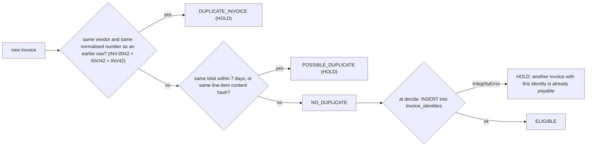

Level 3 is the database guaranteeing it — even a bug in levels 1–2 or a concurrent run can't make the same identity
payable twice. A duplicate can still exist as a *held* row for the reviewer to see.

**`make_eligible`** (called by `s_decide` and by human release) claims the identity, increments `po_lines.qty_invoiced`
for each mapped line (the `CHECK` constraint refuses over-consumption), and sets the PO to `PARTIALLY_INVOICED` or
`CLOSED`.

**MSME deadline**: for `micro`/`small` vendors that are not traders, `accepted_date + 45 days` (written agreement) or
`+ 15 days` (no agreement), per Sec 15 MSMED Act / Income-tax 43B(h).

---

## 9. Reason codes and the decision engine (`reasons`)

A reason is `{code, severity, message, fact_ids[], stage, …extra}`. `reasons.SEVERITY` is the **single** mapping from
code to severity; a code not in the table is `OK` (a passed check kept as evidence). Because the decision reads only
severities, the same facts always give the same decision regardless of wording (golden case 16: a re-worded,
re-laid-out copy of case 01 gets the identical decision).

| Severity | Codes |
|---|---|
| **BLOCK** | `INVALID_GSTIN`, `BANK_CHANGE_FRAUD`, `VENDOR_BLOCKED` |
| **HOLD** | `EXTRACTION_FAILED`, `ARITHMETIC_MISMATCH`, `GSTIN_FORMAT`, `INVOICE_DATE_FUTURE`, `INVOICE_TOO_OLD`, `IFSC_FORMAT`, `IFSC_NOT_FOUND`, `PAN_MISMATCH`, `GSTIN_MISMATCH`, `VENDOR_NOT_APPROVED`, `UNVERIFIABLE_VENDOR`, `VENDOR_ON_HOLD`, `NO_PO`, `PO_VENDOR_MISMATCH`, `OVER_BILLED`, `NOT_RECEIVED`, `PRICE_VARIANCE`, `UNMATCHED_LINE`, `DUPLICATE_INVOICE`, `POSSIBLE_DUPLICATE`, `BANK_DETAILS_CHANGED`, `BANK_CHANGE_REQUEST`, `SENDER_DOMAIN_MISMATCH`, `REPLY_TO_MISMATCH`, `SENDER_NOT_VERIFIED_AT_VENDOR`, `PRESSURE_LANGUAGE`, `IFSC_LOCATION_MISMATCH`, `BENEFICIARY_NAME_MISMATCH`, `SOURCE_UNAVAILABLE`, `RUN_CEILING_REACHED`, `LOW_TRUST`, `ADVERSE_NEWS`, `PIPELINE_ERROR` |

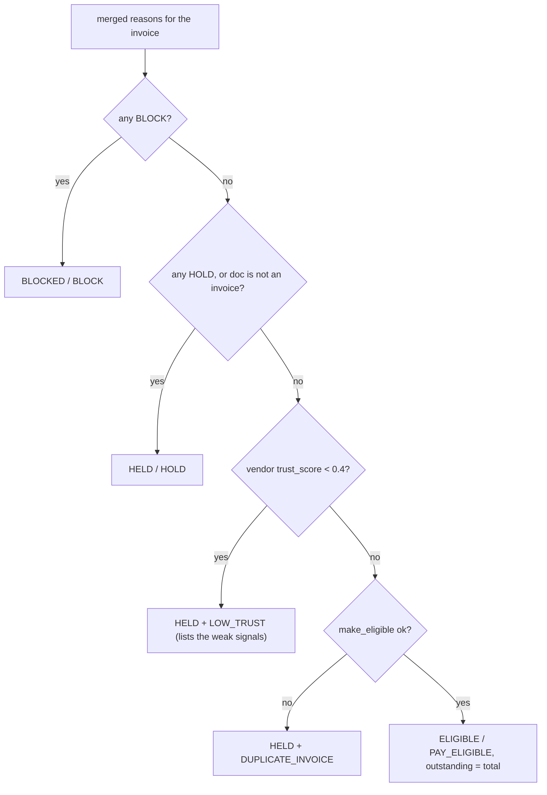

`sort_reasons` orders BLOCK → HOLD (by the `PRIORITY` list, most serious first: fraud, invalid GSTIN, duplicates,
bank changes, …) → passed checks. `_explain` builds the one-line explanation from the top three issues, or from the
key passed checks for eligible invoices.

---

## 10. Document extraction (`extract`)

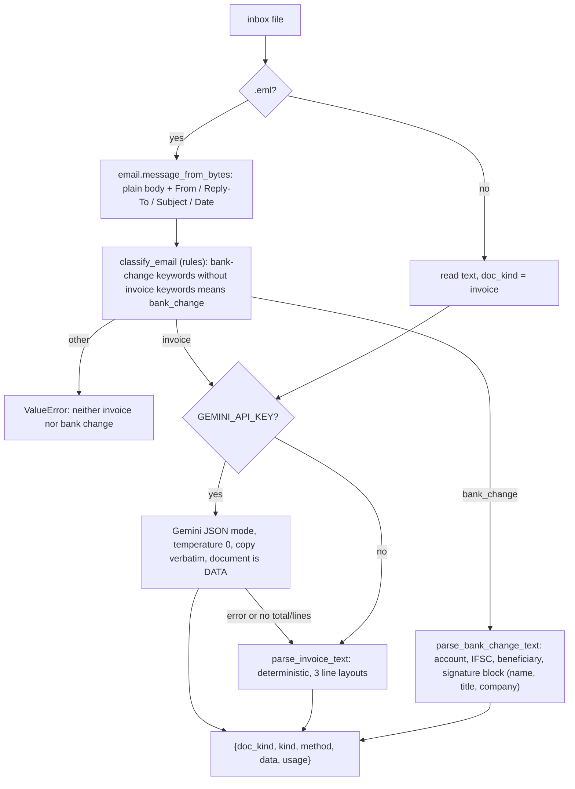

- The deterministic parser understands three invoice layouts (pipe table, `N. item — qty x ₹price @ GST% = amount`,
  and `- item x qty @ price (GST%) = amount`) plus label variants for vendor, GSTIN, invoice number, dates
  (`dd/mm/yyyy` Indian convention, `12 Nov 2026`, ISO), PO, CGST/SGST/IGST, totals and bank details.
- Amounts are converted to paise by `money.to_paise` (`'Rs. 1,20,000/-'` → `12000000`).
- Prompt-injection stance: invoice/email text is data. The LLM prompt says so explicitly, and the LLM output is only
  ever *fields* — every decision is made by rules.
- Results are cached by file sha256 in the `cache` table, so a re-run never re-extracts or re-calls the model. LLM token
  usage and estimated ₹ cost are recorded in `calls`.

---

## 11. Deterministic validators (`validators`)

| Function | Purpose |
|---|---|
| `gstin_check_char` / `gstin_checksum_ok` | GSTIN mod-36 check-digit (alternating weights 1/2, `p//36 + p%36`) |
| `gstin_format_ok`, `ifsc_format_ok` | Regex formats (`^[A-Z]{4}0[A-Z0-9]{6}$` for IFSC) |
| `norm_invoice_no` | `INV-0042`, `INV/42`, `inv 42` → `INV42` (strip non-alnum, drop leading zeros in digit runs) |
| `normalize_name` | lower-case, `&`→`and`, strip punctuation and legal suffixes (pvt, ltd, llp, …) |
| `skeleton` | Confusable folding for homoglyph lookalikes: `I`/`|`/`1`→`l`, `0`→`o`, `rn`→`m`, `vv`→`w` |
| `similarity` | `difflib.SequenceMatcher` ratio |
| `domain_of`, `domain_core`, `edit_distance` | Sender-domain parsing and lookalike detection (Levenshtein ≤ 2 on the domain core) |
| `content_hash` | sha256 of sorted `(normalised item, qty, unit_price)` — catches re-numbered copies |
| `pressure_terms` | "urgent", "immediately", "do not call", "account frozen", "within 24 hours", … |

No LLM is used anywhere in this module.

---

## 12. External sources layer (`sources`)

Every call to Crustdata or the IFSC API goes through one wrapper, `_call()`, which returns a `Result
{data, raw_response_id, retrieved_at, source_ref, mode, cached, credits, recorded}` or raises `SourceUnavailable`
(`CeilingReached` is a subclass).

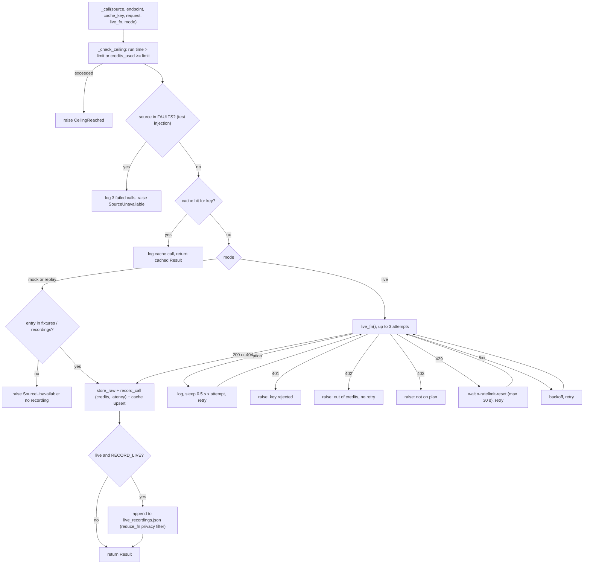

Design rules encoded here:

- **Silence is never "no problem."** Timeouts, missing recordings and exhausted retries raise `SourceUnavailable`,
  which the pipeline turns into a `SOURCE_UNAVAILABLE` HOLD ("I can't verify …").
- **Fault injection runs before the cache**, so a cached answer can't mask a simulated outage (golden case 12).
- **404 is an answer** (e.g. IFSC doesn't exist) and is cached as `data = None`.
- **Credits**: taken from the `x-credits-used` header when present, else computed per endpoint; summed into
  `pipeline_runs.credits_used`, which the ceiling check reads before the next call.
- **Privacy**: person-search responses are reduced to `{count, matches:[{title, current_company_id}]}` before being
  written to the committed recordings file — no names, no profile URLs.

### Endpoints

| Function | HTTP | Cache key | Credits | Used for |
|---|---|---|---|---|
| `company_identify(domain=…)` | `POST /company/identify` | `crust:identify:domain:<d>` | 0.2 / match | Vendor identity, sender-domain owner |
| `company_identify(name=…)` | `POST /company/identify` | `crust:identify:name:<n>` | 0.2 / match | Registry lookup for unknown vendors |
| `company_enrich(id)` | `POST /company/enrich` (explicit `fields`) | `crust:enrich:<id>` | 2 / match | Founded year, headcount + YoY growth, primary domain, HQ |
| `person_search(cid, name)` | `POST /person/search` (filter tree) | `crust:person:<cid>:<name>` | 0.23 / profile | Does the email signatory work at the vendor? |
| `finance_contacts(cid)` | `POST /person/search` (title regex) | `crust:finance_contacts:<cid>` | 0.23 / profile | Second contact for bank-change checklist |
| `adverse_news(name)` | `POST /web/search/live` (`sources:["news"]`) | `crust:news:<name>` | 1 if results else 0 | Insolvency news |
| `web_fetch(url)` | `POST /web/enrich/live` | `crust:fetch:<url>` | 1 / page | Article publish date |
| `ifsc_lookup(ifsc)` | `GET ifsc.razorpay.com/<ifsc>` | `ifsc:<code>` | free | Bank, branch, city, state |

Identify-then-enrich-by-id avoids paying 2 credits for each fuzzy match a domain or name can return.

---

## 13. Trust and priority scoring (`scoring`)

Two **separate** scores, on purpose: *trust* answers "is it safe to pay at all?" (a **gate**); *priority* answers
"who first?" (an **order**). A single blended score would let a loyal vendor's history paper over a fraud signal.
A missing signal contributes 0 and is labelled "can't verify" — never imputed.

### Trust (gate: < 0.4 → `LOW_TRUST` HOLD)

| Signal | Weight | Value | Source |
|---|---|---|---|
| `identity` | 0.25 | 1.0 if GSTIN checksum + PAN consistent **and** Crustdata identifies the vendor's domain; 0.5 if only one; else 0 | validators + Crustdata identify |
| `company_age` | 0.15 | `min(1, years_since_founded / 10)` | Crustdata enrich `basic_info.year_founded` |
| `headcount_stability` | 0.15 | 1.0 if YoY ≥ 0, else `max(0, 1 + yoy/30)` | enrich `headcount.growth_percent.yoy` (timeseries fallback) |
| `domain_consistency` | 0.15 | 1.0 if vendor-master domain == Crustdata primary domain | enrich `basic_info.primary_domain` |
| `bank_stability` | 0.15 | `min(1, months_since_valid_from / 6)`; **0 if any pending/rejected bank change** | `vendor_bank_accounts` |
| `no_adverse_news` | 0.15 | 0 if any adverse article, else 1 | Crustdata web search + fetch |

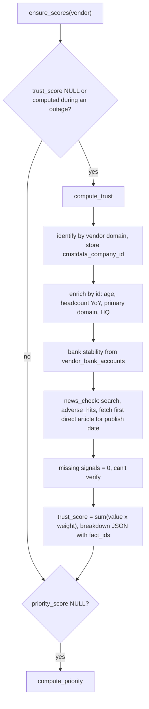

Trust is invalidated (`trust_score = NULL`) whenever a bank change is proposed or approved, and any breakdown row with
`source_error` forces recomputation on next use — a score computed during an outage is provisional.

### Priority (order within a tier)

| Signal | Weight | Value |
|---|---|---|
| `critical_supplier` | 0.25 | 1 if critical / sole supplier |
| `relationship_years` | 0.15 | `min(1, years / 5)` |
| `clean_match_rate` | 0.20 | `hist_clean / hist_invoices` |
| `on_time_delivery` | 0.20 | `hist_on_time / hist_deliveries` |
| `low_dispute_rate` | 0.10 | `max(0, 1 − 5 × disputes / invoices)` |
| `msme_small_supplier` | 0.10 | 1 if micro/small and not a trader |

### Adverse-news matcher

A result is adverse only if its title+snippet contains **the company name** *and* an **insolvency term**
(`insolvency`, `cirp`, `corporate insolvency resolution`, `liquidation`, `liquidator`, `resolution professional`,
`winding up`). "NCLT" alone and bare "default" are deliberately excluded — real recorded data showed NCLT
merger/demerger approvals and a different "Thermax Group" defaulting. For the first direct (non-Google-redirect)
article URL, `web_fetch` extracts the publish date from `article:published_time`, JSON-LD `datePublished`, or the page
text "Published On …". In the pipeline, adverse news is a **HOLD on its own** (`ADVERSE_NEWS`), even when every
internal check passes (golden case 18).

---

## 14. Receivables forecast and cash position

`receivables.forecast_all` runs at setup for every customer:

```
health     = 0.5 × headcount_trend_score + 0.5 × (0 if adverse news else 1)
confidence = 0.7 × past_on_time_rate + 0.3 × health
```

`scheduler.cash_position` builds the money available for this run:

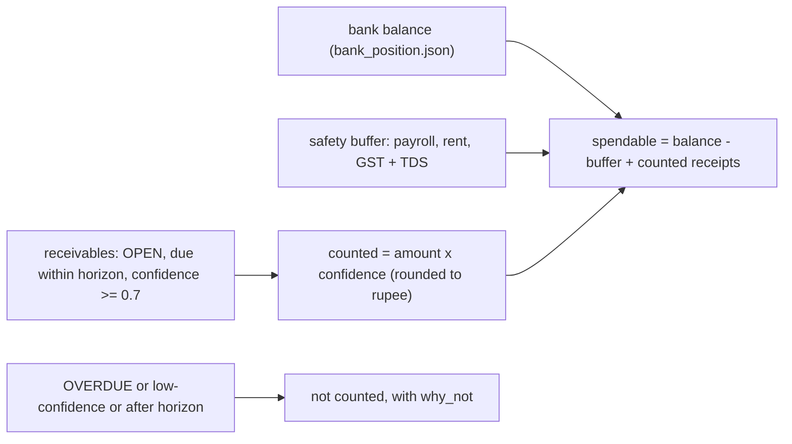

Overdue receivables are never counted as expected cash.

---

## 15. Payment planning (`scheduler`)

`plan()` is a pure computation (no writes); `propose_run()` persists it.

### Tier classification (`classify`)

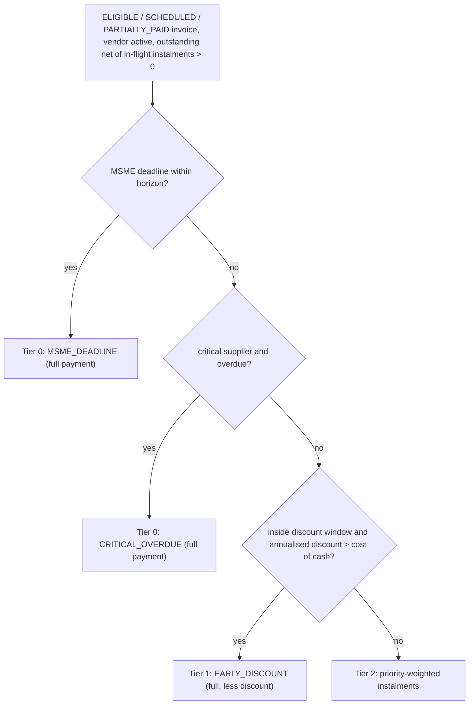

Annualised discount = `(d / (1 − d)) × 365 / (credit_days − discount_days)`; e.g. 2/10 net 30 ≈ 37 % vs 12 % cost of cash.

### Allocation (greedy, explainable)

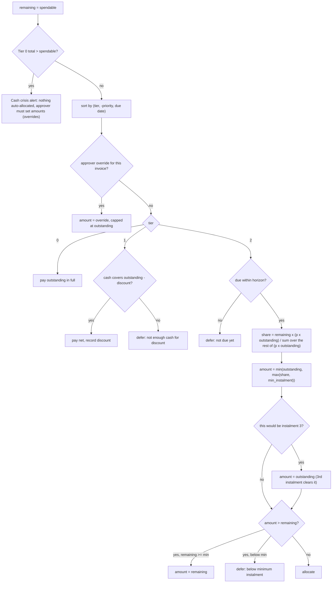

`min_instalment = min(outstanding, max(25 % of total, ₹10,000))`, at most 3 instalments per invoice. Every proposal
carries a `justification` JSON: tier, headline ("₹X of ₹Y now"), reasons (MSME deadline / discount / relationship /
bank stability / scores / instalment number), cash left after it, and when and why the remainder is planned
("after ₹N expected from <customer> on <date>"). Alerts flag MSME deadlines within 3 days and open discount windows.

LP optimisation was rejected on purpose: every rupee must be explainable to the approver in one sentence.

### Payment-run lifecycle

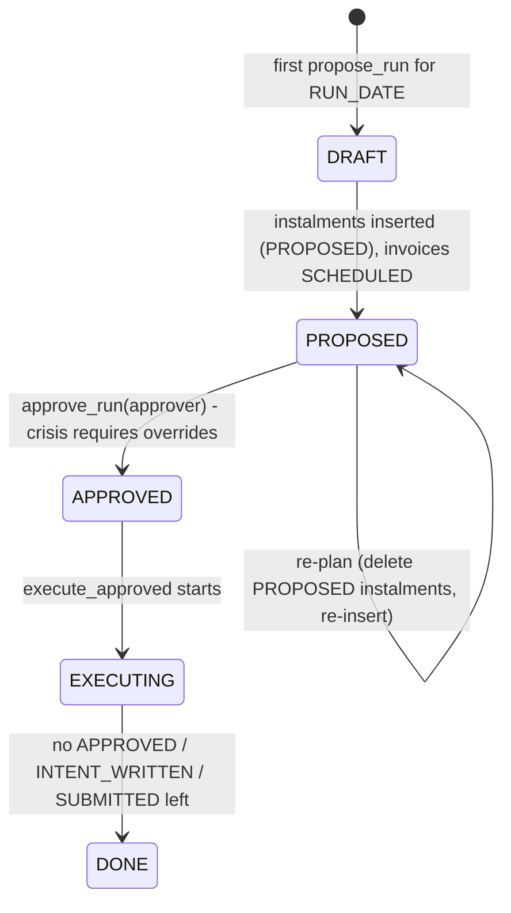

Each instalment gets a fresh `idem_key` (UUID hex) **at insert time** and it is never regenerated. Re-planning is only
allowed while the run is `DRAFT`/`PROPOSED`. The bank-balance fact used for the plan is written to `facts` and
referenced from every justification.

---

## 16. Exactly-once payment execution (`payments`)

### Provider protocol

```python
class PaymentProvider(Protocol):
    name: str
    def create_payout(self, idem_key, amount_paise, beneficiary, narration) -> ProviderResult: ...
    def get_status(self, idem_key) -> ProviderResult: ...
```

- **`MockProvider`** persists payouts in its own table (`mock_provider_payouts`, PK `idem_key`) as if it were a separate
  system, with true idempotency: the same key returns the existing payout. Optional latency / failure rate.
- **`RazorpayXProvider`** posts to `/v1/payouts` with the `X-Payout-Idempotency` header and `reference_id = idem_key`;
  refuses to start with `rzp_live_` keys.

### Instalment state machine

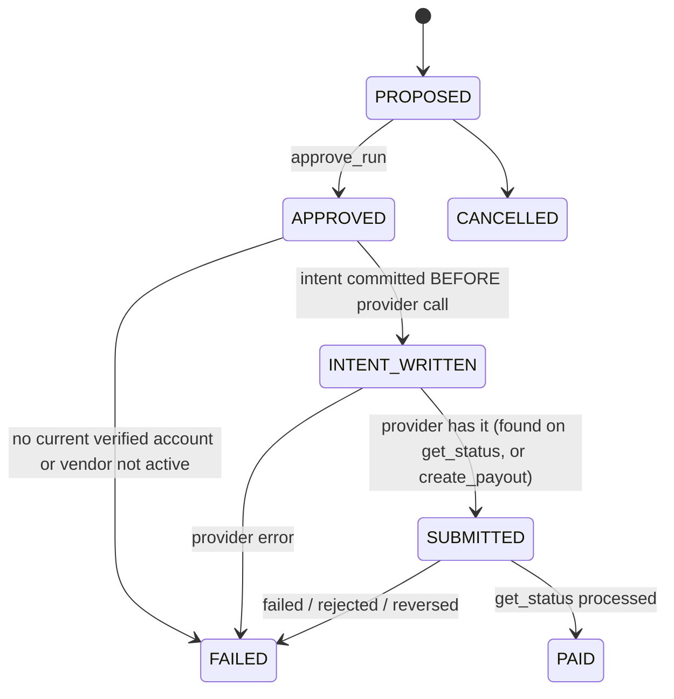

### Crash-safe sequence

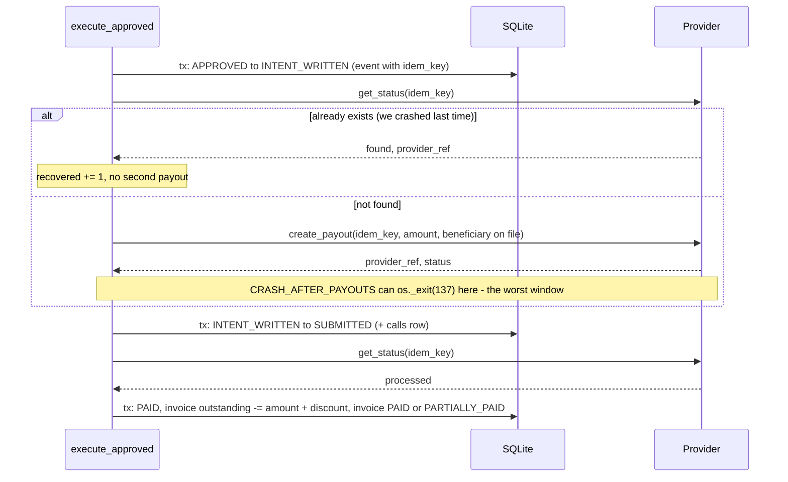

Why no rupee can be paid twice:

1. The intent is durably written before the provider is called.
2. On restart, anything in `INTENT_WRITTEN`/`SUBMITTED` is reconciled by **asking the provider about the same key
   first**; a key is never regenerated.
3. The provider itself deduplicates on the key.
4. `_mark_paid` is idempotent (no-op if already `PAID`), and the `instalments_cap` trigger bounds the total.
5. The beneficiary is **always** the vendor's `current` account from the vendor master — never bank details from an
   invoice or email — and only for `active` vendors.

---

## 17. Bank-change fraud defence

There are two entry points: a bank-change email arriving in the inbox (pipeline), and a user pasting an email/SMS into
the invoice overlay's Bank details tab (`bank_verify`). Both end in the same maker-checker checklist (`vendor_admin`).
**An email can never update the vendor master; it can only create a `pending_verification` account.**

### 17.1 In the pipeline (`_check_bank_change`)

```mermaid
flowchart TD
    e[".eml classified bank_change"] --> res["resolve: claimed vendor by name (else UNVERIFIABLE_VENDOR)"]
    res --> req["BANK_CHANGE_REQUEST (HOLD): call phone on file, second person approves"]
    req --> snd["sender checks: domain vs vendor domain (Crustdata identify foreign domain, lookalike if edit distance <= 2), Reply-To"]
    snd --> ppl["signatory: Crustdata person search at vendor's company id"]
    ppl --> prs["pressure language"]
    prs --> bk["IFSC live lookup: branch state vs vendor state, beneficiary name"]
    bk --> dom{"sender domain bad?"}
    dom -->|yes| fraud["BANK_CHANGE_FRAUD (BLOCK); at decide vendor set on_hold"]
    dom -->|no| hold["stays HOLD"]
    fraud --> pend
    hold --> pend["insert vendor_bank_accounts row: pending_verification (once per source doc), trust_score reset"]
```

Golden case 07 (lookalike `astral-pipes.co`, Gmail Reply-To, "do not call our office line", Jharkhand branch for a
Gujarat company) → **BLOCK**. Case 19 (GACL from its own `gacl.com`, no pressure) → **HOLD** `BANK_CHANGE_REQUEST`.

### 17.2 Paste-and-verify (`bank_verify.verify`)

`extract_request` parses the pasted email (headers optional) with rules, extracts account / IFSC / phone numbers from
the SMS, and only if fields are still missing asks the LLM to *extract* (never to judge). Checks:

| # | Check | Status |
|---|---|---|
| 1 | Request has account + IFSC; same as on file? | `REQUEST_INCOMPLETE` unknown / `SAME_AS_ON_FILE` ok |
| 2 | Email account vs SMS account; call-back number in the message ≠ phone on file | `EMAIL_SMS_CONFLICT` bad / `DIFFERENT_CALLBACK_NUMBER` bad |
| 3 | Sender domain vs vendor domain (Crustdata identify); Reply-To | `SENDER_DOMAIN_MISMATCH` bad / `REPLY_TO_MISMATCH` bad |
| 4 | Requester on Crustdata people search; finance title? | `REQUESTER_IN_FINANCE` ok / `REQUESTER_NOT_FINANCE` warn / `REQUESTER_NOT_FOUND` unknown |
| 5 | IFSC branch state vs vendor state (Telangana ≡ Andhra Pradesh legacy mapping) | `IFSC_BRANCH` ok/warn, `IFSC_NOT_FOUND` bad |
| 6 | Beneficiary name vs legal name/aliases | `BENEFICIARY_OK` / `BENEFICIARY_MISMATCH` bad |
| 7 | Pressure language; adverse news from the trust breakdown | warn / bad |

```mermaid
flowchart TD
    ch["checks[]"] --> same{"SAME_AS_ON_FILE?"}
    same -->|yes| g1["GENUINE: no change"]
    same -->|no| bad{"any bad?"}
    bad -->|yes| fr["FRAUD: reject unless confirmed on number on file"]
    bad -->|no| gen{"SENDER_DOMAIN_OK and REQUESTER_IN_FINANCE and no warn/unknown?"}
    gen -->|yes| g2["GENUINE: still call back before approving"]
    gen -->|no| un["UNVERIFIED: call back first"]
```

`record_request` stores the request as a `pending_verification` account (never `current`), resets trust, and puts the
vendor `on_hold` if the verdict was FRAUD. Whatever the verdict, the checklist below is mandatory.

### 17.3 Maker-checker checklist (`vendor_admin`)

```mermaid
stateDiagram-v2
    [*] --> pending_verification : email or pasted request
    state pending_verification {
        [*] --> Docs
        Docs : 1. documents received (cancelled cheque / bank letter)
        Callback : 2. call-back on phone_on_file only
        Second : 3. second contact (Crustdata finance titles, never the sender) - recommended
        Penny : 4. penny drop - bank-registered name must match legal name
        Notify : 5. notify OLD contact on file (draft, human click, mock send)
        Docs --> Callback
        Callback --> Second
        Second --> Penny
        Penny --> Notify
    }
    pending_verification --> current : approve_bank_change (no blockers, approver differs from proposer and caller)
    pending_verification --> rejected : reject_bank_change
    current --> retired : a later change is approved
```

`approval_blockers` refuses approval when: documents not received, no call-back, penny drop not run / failed /
`name_mismatch`, approver == proposer, or approver == whoever did the call-back. On approval, in one transaction: the
old `current` account is `retired` (with `valid_to`), the new one becomes `current`, and trust is reset. Every step
writes an `events` row with the actor; evidence steps also write `facts`. Golden case 20 pays the new account after the
checklist; case 20b's penny drop returns "R K TRADING COMPANY" and approval is refused.

The penny drop is mocked (`penny_drop_mock.json`, facts labelled `penny_drop_mock`) because Razorpay Account
Validation isn't available in test mode.

---

## 18. Evidence and audit ledger (`ledger`)

```mermaid
flowchart LR
    ext["external call"] --> raw["raw_responses: endpoint, request, response, status"]
    ext --> calls["calls: tool, endpoint, mode, credits, tokens, est INR, latency, ok, http status"]
    raw --> facts["facts: entity, key, value, source_type, source_ref, source_field, retrieved_at, recorded"]
    file["invoice file"] --> facts
    human["human step"] --> facts
    facts --> reasons["reason.fact_ids[]"]
    reasons --> ui["UI: expandable evidence per reason"]
    tr["every state transition"] --> events["events: seq, entity, from_state, to_state, actor, detail"]
```

| Table | Written by | Purpose |
|---|---|---|
| `facts` (append-only) | `add_fact`, `add_src_fact` | Every value a decision relies on, with its source, exact JSON field path and retrieval time. `recorded=1` marks replayed real data. |
| `events` (append-only) | `add_event` | State-machine history with actor — invoices, vendors, bank accounts, runs, instalments |
| `calls` | `record_call` | Cost/latency ledger, incl. cache hits and injected faults; feeds the run credit ceiling and cost-per-invoice |
| `raw_responses` | `store_raw` | Full response bodies (the evidence behind source facts) |
| `cache` | `sources`, `s_extract` | Per-key memo; each vendor costs credits once |

The UI's `render_fact` shows provenance badges: 🌐 live / 🌐 live, recorded <date> · 🧪 mock fixture ·
🧪 penny drop (mock) · 👤 person · 📄 record.

---

## 19. Human-in-the-loop actions

| Action | Function | Guard rails |
|---|---|---|
| Release a HOLD | `pipeline.release_with_note(inv, actor, note)` | Name + note required; only `HELD` invoices with a resolved vendor; still goes through `make_eligible` (identity + PO qty); `BLOCK` can never be released; adds `RELEASED_BY_HUMAN` reason and an `override` event |
| Re-check | `pipeline.recheck` + `process_one` | Resets to `EXTRACTED` keeping extraction reasons; every check runs again |
| Approve payment run | `scheduler.approve_run(run, approver)` | Approver name required; run must be `PROPOSED`; cash-crisis runs need explicit overrides |
| Approve bank change | `vendor_admin.approve_bank_change` | See §17.3 |
| Put vendor on hold / block | `vendor_admin.set_vendor_status` | Name + note required, evented |

After any release/recheck in the overlay, `_replan` re-proposes the payment run (only while it is `DRAFT`/`PROPOSED`).

---

## 20. Background worker

```mermaid
flowchart LR
    s["python -m app.worker"] --> d["drain(): run_pipeline + execute_approved"]
    d --> p{"--once?"}
    p -->|yes| x["print result, exit"]
    p -->|no| sl["sleep 2 s"] --> d
```

Because every transition is transactional and work is claimed with an expiring lock, the worker can be killed at any
point and restarted; in-flight payouts are reconciled by idempotency key (§16).

---

## 21. Weekly summary (`summary`)

`week_summary(conn)` is a read model over `invoices`, `instalments`, `payment_runs` and `calls` that powers the Results
screen: counts and values for eligible / held / blocked; **fraud** count (documents with any of
`BANK_CHANGE_FRAUD, SENDER_DOMAIN_MISMATCH, BANK_DETAILS_CHANGED, REPLY_TO_MISMATCH, INVALID_GSTIN, GSTIN_MISMATCH,
PAN_MISMATCH, UNVERIFIABLE_VENDOR, BENEFICIARY_NAME_MISMATCH`, or a lookalike `VENDOR_NOT_APPROVED`) and the payables
value protected; duplicates caught; per-tier totals; discounts captured; MSME payments made on time; top hold reasons;
total credits / ₹ cost and cost per invoice; and one row per document with its outcome ("Pay in full", "Pay part now",
"Deferred — …", "Held for review", "Blocked").

---

## 22. Accounting import (`importer`)

```mermaid
flowchart LR
    csv["data/seed/*.csv"] --> imp["CsvImporter"]
    tally["tally_export_sample.csv"] --> imp
    imp -->|AccountingSource protocol| load["importer.load (one transaction)"]
    load --> v["vendors + aliases"]
    load --> b["vendor_bank_accounts (current, verified at onboarding)"]
    load --> po["purchase_orders + po_lines (CSV and Tally Purchase Order vouchers; vendor by GSTIN)"]
    load --> g["grns (CSV and Tally Receipt Note vouchers) -> qty_received, PO status"]
    load --> c["customers + receivables"]
```

`AccountingSource` is the interface a live TallyPrime (XML over HTTP) or Busy connector would implement.

---

## 23. Scripts, test harness and crash demo

| Script | What it does |
|---|---|
| `scripts/setup_demo.py [--run]` | Regenerates mock data, drops all tables (Windows-safe while the UI holds the file), `init_schema`, imports seed data, forecasts receivables; `--run` also runs the pipeline and proposes a payment run. Also used by the UI's "↺ Reset demo". |
| `scripts/run_test_set.py` | Golden test set (21 cases) from a clean DB against `data/golden/expected.json`. Case 12 injects faults via `sources.FAULTS`; 16 runs in isolation and compares with case 01; 17 is the crash demo; 18 must be held only by a recorded news fact; 20/20b drive the bank-change checklist. |
| `scripts/crash_demo.py` | Fresh DB → pipeline → propose + approve → worker with `CRASH_AFTER_PAYOUTS=2` (hard `os._exit(137)` right after the provider accepted a payout) → restart worker → asserts provider payouts == approved instalments, and `paid + discount + outstanding == total` per invoice. |
| `scripts/record_live.py` | Runs the real pipeline in live mode on a scratch DB to record exactly the cache keys replay will ask for; prints Crustdata credit balance before/after; `--ifsc-only`, `--pick`. |
| `scripts/generate_mock_data.py` | Builds the synthetic seed data, inbox documents and fixtures. |
| `tests/test_intent.py` | Prompt-parser unit tests (scope parsing, refusals, rejections). |

---

## 24. Failure handling matrix

| Failure | Where caught | Outcome |
|---|---|---|
| Unreadable document | `s_extract` (2 attempts) | `HELD` + `EXTRACTION_FAILED` |
| Gemini error / quota / bad JSON | `extract` | Falls back to the deterministic parser; method recorded |
| Crustdata/IFSC timeout, 5xx, 429 exhaustion | `sources._call` | `SourceUnavailable` → `SOURCE_UNAVAILABLE` HOLD; trust recomputed next time |
| 401 / 402 / 403 | `sources._call` | Fail fast with a clear message, no retry → HOLD |
| No recording in replay mode | `sources._call` | `SourceUnavailable` ("run record_live.py with a key") |
| Run exceeds time/credit ceiling | `_check_ceiling` | `RUN_CEILING_REACHED` HOLD |
| Bug inside a stage | `pipeline.step` | Transaction rolled back; retried; 3rd failure → `HELD` + `PIPELINE_ERROR` |
| Two runners on one invoice | `claim_next` | 60 s expiring lock; `BEGIN IMMEDIATE` serialises writers |
| Duplicate slips past checks | `invoice_identities` PK | `IntegrityError` → `HOLD` |
| Over-invoicing a PO | `po_lines CHECK` | `IntegrityError` → can't release / held |
| Crash mid-payout | `execute_approved` restart | Reconciled via `get_status(idem_key)`; no second payout |
| Vendor put on hold after approval | `_beneficiary` | Instalment `FAILED`, nothing sent |
| Cash shortfall for legal dues | `plan` | Crisis alert; nothing auto-allocated; approval requires manual amounts |

---

## 25. Safety invariants (summary)

1. **Rules decide, never the LLM.** The LLM (optional) only extracts fields or classifies a prompt's relevance.
2. **A prompt can't weaken a check.** Override phrases are recorded in `refused` and ignored.
3. **Pay only to the account on file**, only for active vendors, never to details from an invoice or email.
4. **An email can't change the vendor master.** Bank changes need documents, a call-back on the number on file, a
   matching penny drop, and approval by someone other than the proposer and the caller.
5. **Silence is not "OK."** Every unavailable source becomes an explicit "can't verify" HOLD.
6. **Pay each invoice once** — three duplicate layers, the last one a database primary key.
7. **Pay each instalment once** — intent-before-call, frozen idempotency keys, reconcile-before-retry.
8. **Never overpay** — `instalments_cap` trigger and `outstanding >= 0`.
9. **Every decision is explainable** — reason codes with fact IDs, facts with source/field/date, append-only events.
10. **Money is integer paise** — no floating-point rupees anywhere in storage.

---

## 26. Swap points for production

| Prototype | Production replacement | Seam |
|---|---|---|
| SQLite (WAL) | Postgres / Supabase (same constraints; `FOR UPDATE SKIP LOCKED`) | `app/db.py` |
| CSV + Tally CSV export | Live TallyPrime XML / Busy | `importer.AccountingSource` |
| Inbox folder | Gmail / IMAP ingestion | `pipeline.ingest` |
| `.txt`/`.eml` parser | PDF / OCR + LLM extraction | `extract.extract` |
| `MockProvider` | RazorpayX (test → live) | `payments.PaymentProvider` |
| `penny_drop_mock` | Razorpay Account Validation | `vendor_admin._penny_provider` |
| Replay recordings | Live Crustdata (+ Watch-based monitoring between runs) | `CRUSTDATA_MODE=live` |
| GSTIN checksum only | GST portal registration status (captcha-gated today) | `s_validate` |
